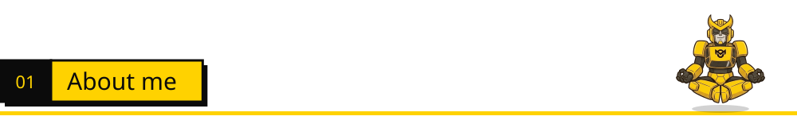
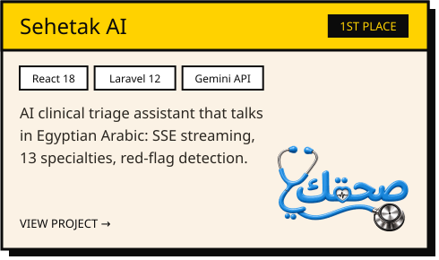
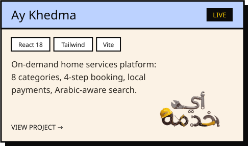
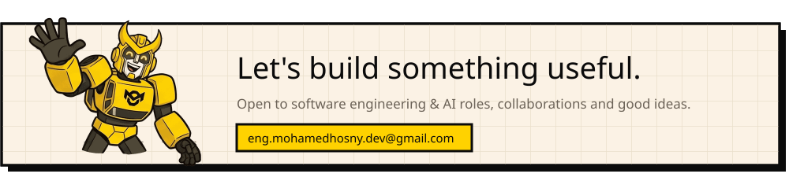

  <picture><source media="(prefers-color-scheme: dark)" srcset="assets/hero-dark.svg"></picture>

  <a href="https://www.linkedin.com/in/eng-mohamedhosny/"><picture><source media="(prefers-color-scheme: dark)" srcset="assets/btn-linkedin-dark.svg"></picture></a>
  <a href="https://x.com/EngMoHosny"><picture><source media="(prefers-color-scheme: dark)" srcset="assets/btn-x-dark.svg"></picture></a>
  <a href="https://www.youtube.com/@eng-mohamed-hosny"><picture><source media="(prefers-color-scheme: dark)" srcset="assets/btn-youtube-dark.svg"></picture></a>
  <a href="https://www.instagram.com/eng.mohamedhosny/"><picture><source media="(prefers-color-scheme: dark)" srcset="assets/btn-instagram-dark.svg"></picture></a>
  <a href="https://www.threads.net/@eng.mohamedhosny"><picture><source media="(prefers-color-scheme: dark)" srcset="assets/btn-threads-dark.svg"></picture></a>
  <a href="https://www.facebook.com/eng.mohamedhosny.dev"><picture><source media="(prefers-color-scheme: dark)" srcset="assets/btn-facebook-dark.svg"></picture></a>
  <a href="mailto:eng.mohamedhosny.dev@gmail.com"><picture><source media="(prefers-color-scheme: dark)" srcset="assets/btn-email-dark.svg"></picture></a>

<picture><source media="(prefers-color-scheme: dark)" srcset="assets/h-about-dark.svg"></picture>

I'm **Mohamed Hosny**, a software engineer who builds with AI every day, and I share what I learn so you can use AI in your daily work too.

- **1st Place, Router Plex AI Hackathon.** Built *Sehetak AI*, an LLM-powered medical triage assistant that speaks Egyptian Arabic.
- **AI automation.** Autonomous agents, multi-agent workflows, agent delegation, RAG pipelines and n8n integrations.
- **Frontend engineering.** Ex-Frontend Intern at Eduzah: sprint deliverables, feature architecture and team Git workflows.
- **Problem solving.** 500+ problems on [Codeforces](https://codeforces.com/profile/MohamedHosni_54) and [LeetCode](https://leetcode.com/u/MoahmedHosni/). Computer Science student at Sohag University.

<picture><source media="(prefers-color-scheme: dark)" srcset="assets/h-highlights-dark.svg"></picture>
<picture><source media="(prefers-color-scheme: dark)" srcset="assets/highlights-dark.svg"></picture>

<picture><source media="(prefers-color-scheme: dark)" srcset="assets/h-stack-dark.svg"></picture>
<picture><source media="(prefers-color-scheme: dark)" srcset="assets/stack-dark.svg"></picture>

<picture><source media="(prefers-color-scheme: dark)" srcset="assets/h-work-dark.svg"></picture>

  <a href="https://github.com/Eng-MohamedHosny/Ai-Hackathon-Project"><picture><source media="(prefers-color-scheme: dark)" srcset="assets/p-sehetak-dark.svg"></picture></a>
  <a href="https://github.com/Eng-MohamedHosny/Any-Service-Project"><picture><source media="(prefers-color-scheme: dark)" srcset="assets/p-anyservice-dark.svg"></picture></a>

  <b>Sehetak AI</b>: <a href="https://sehetak-ai.pages.dev">Live demo</a> · <a href="https://github.com/Eng-MohamedHosny/Ai-Hackathon-Project">Code</a>
  &nbsp;&nbsp;|&nbsp;&nbsp;
  <b>Ay Khedma</b>: <a href="https://any-service.vercel.app">Live demo</a> · <a href="https://github.com/Eng-MohamedHosny/Any-Service-Project">Code</a>

<picture><source media="(prefers-color-scheme: dark)" srcset="assets/h-connect-dark.svg"></picture>

<a href="mailto:eng.mohamedhosny.dev@gmail.com"><picture><source media="(prefers-color-scheme: dark)" srcset="assets/footer-dark.svg"></picture></a>
